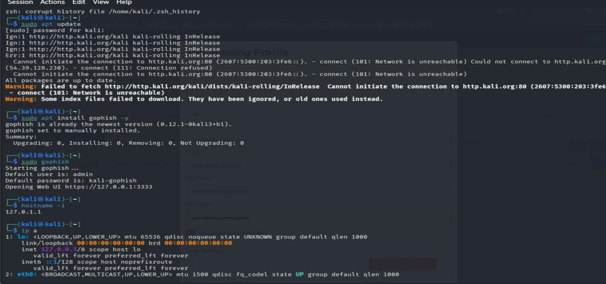

# Experiment 10: Phishing Simulation Using Gophish

## 1. Aim / Objective

To understand how phishing campaigns are designed and executed using Gophish by creating and running a simulated phishing attack in a controlled lab environment and evaluating how well test users recognize phishing attempts.

## 2. Requirements

- Kali Linux or host machine
- Gophish – Open-source phishing simulation framework
- Lab-only SMTP relay
- Lab-created test email accounts
- Isolated lab network with consenting test users

## 3. Procedure

### Step 1: Install and Launch Gophish

Download and install Gophish on the lab machine. Launch the Gophish server and open the admin console at `https://127.0.0.1:3333`. Log in to access the dashboard.

### Step 2: Configure Sending Profile

Open the Sending Profiles section and create a new profile. Configure it to use the lab's SMTP relay so that simulated emails are delivered only to test accounts within the isolated network.

### Step 3: Create Email Template

Navigate to Email Templates and create a sample phishing email using a password-reset or IT-support notification. Add a suitable subject and message to simulate a realistic phishing email.

### Step 4: Create Landing Page

Open the Landing Pages section and create a sample login-style page. Configure it to record simulated interactions only. Do not collect or store real passwords or credentials.

### Step 5: Create Test Recipient Group

Navigate to the Users & Groups section and create a group containing consenting, lab-created test email addresses. Save the group for the campaign.

### Step 6: Launch Phishing Simulation Campaign

Open the Campaigns section and create a new campaign. Select the email template, landing page, sending profile and test recipient group. Launch the campaign within the controlled lab environment.

### Step 7: Monitor and Analyze Results

Open the Results dashboard and observe email opens, link clicks and simulated submission events. Analyze the results to understand user awareness and identify areas requiring further security training.

## 4. Results

The Gophish phishing simulation campaign was configured and executed in a controlled lab environment. Email opens, link clicks and simulated submission events were monitored through the results dashboard.

## 5. Conclusion

The experiment demonstrated how Gophish is used to design and conduct phishing simulations in a controlled environment. It helped understand the role of sending profiles, email templates, landing pages and campaign results. The experiment also highlighted the importance of phishing awareness, cautious link handling and regular security training to protect organizations against phishing attacks.

---
