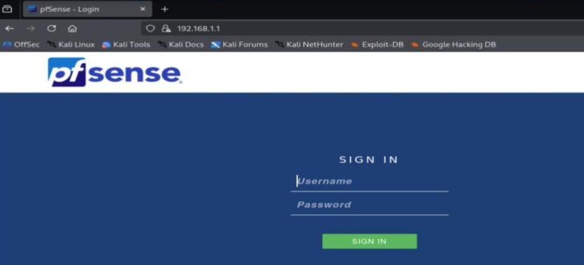
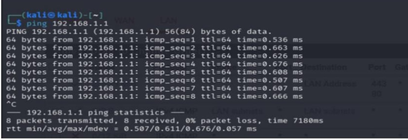
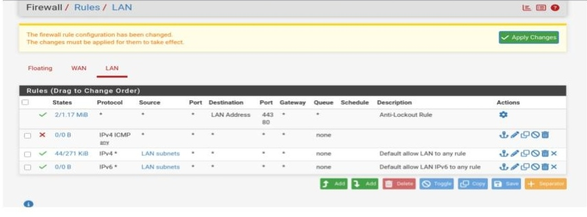
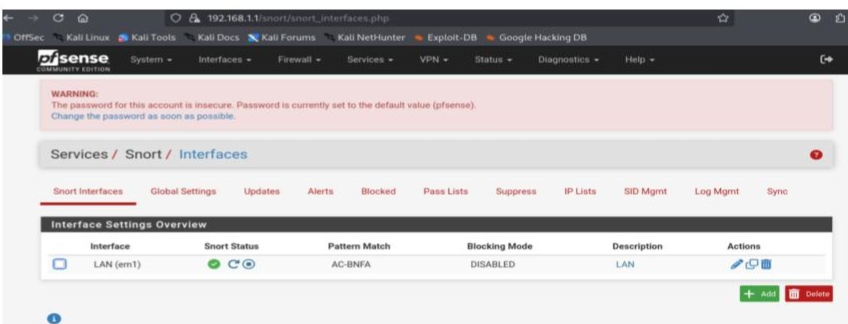
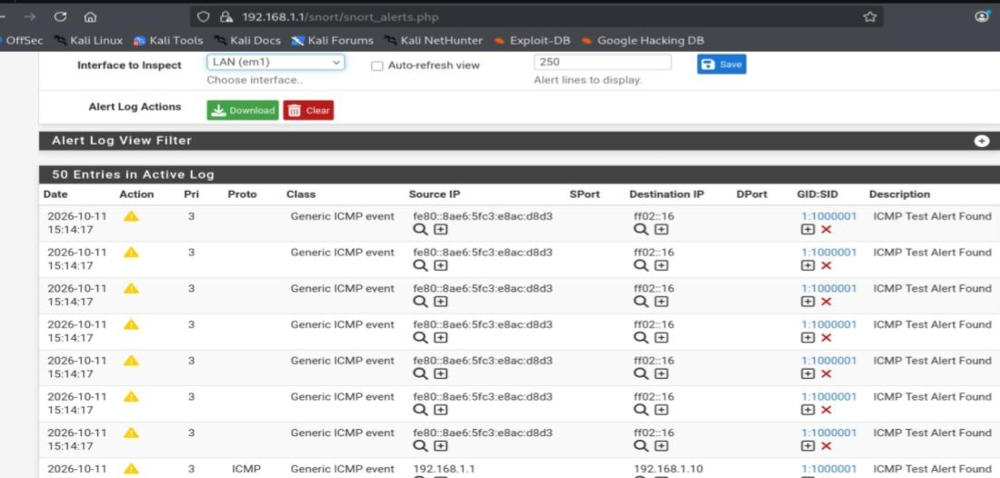

# COM 512 – Offensive and Defensive Security Lab

## Experiment 4: Firewall Configuration and Snort IDS Using pfSense

### Aim

To configure basic firewall rules using pfSense, enable Snort IDS, and simulate network traffic using Kali Linux to observe traffic filtering and malicious activity detection.

### Requirements

- Kali Linux – Attacker
- Metasploitable 2 – Victim
- pfSense – Firewall and IDS
- Oracle VM VirtualBox

### Theory

pfSense is an open-source firewall used to control network traffic. Snort is an Intrusion Detection System (IDS) that monitors network traffic and generates alerts for suspicious activities.

### Procedure

#### Step 1: Set Up Virtual Machines

Create three virtual machines in VirtualBox: Kali Linux, Metasploitable 2, and pfSense. Configure pfSense with WAN and LAN interfaces.


#### Step 2: Install and Configure pfSense

Install pfSense, assign the network interfaces, and configure the LAN IP address. Connect Kali Linux and Metasploitable 2 to the pfSense LAN network.



#### Step 3: Verify Connectivity

Check the IP addresses of the virtual machines and test connectivity from Kali Linux to Metasploitable 2.

```bash
ip addr
ping <target-IP>
```



#### Step 4: Configure Firewall Rules

Open the pfSense web interface and navigate to **Firewall → Rules → LAN**. Add rules to allow or block selected traffic, then apply the changes.



#### Step 5: Install and Enable Snort IDS

Navigate to **System → Package Manager → Available Packages** and install Snort. Then open **Services → Snort**, configure the LAN interface, enable Snort, and apply the settings.



#### Step 6: Generate Test Traffic

From Kali Linux, generate test traffic toward Metasploitable 2 within the isolated lab. Observe the firewall's filtering behavior and check whether Snort detects suspicious traffic.



#### Step 7: Inspect Logs and Alerts

Open the Snort alerts or logs section in pfSense. Examine the recorded events and verify the firewall filtering and IDS detection results.


### Conclusion

pfSense firewall rules were configured to control network traffic, and Snort IDS was enabled to monitor suspicious activity in the virtual lab.

### Result

The configuration of firewall rules, traffic filtering, and intrusion detection using pfSense and Snort was studied successfully.

### Tools Used

- Kali Linux
- Metasploitable 2
- pfSense
- Snort IDS
- Oracle VM VirtualBox
